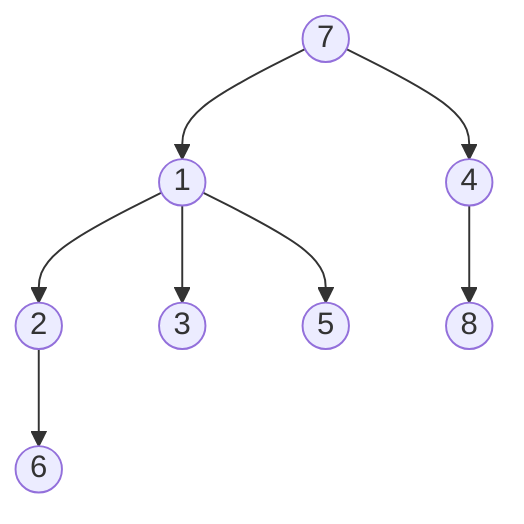

### Задача 1

Аня и Ванката живеят в интересен град - всички улици се събират в централния площад и от него до всяка точка на града може да се стигне по точно една улица. Те разполагат с карта на града, където различните забележителности са номерирани с уникални цели числа. Знаейки точно къде се намират и двамата, те търсят най-близката точка, в която улиците, по които вървят, ще се съберат, за да се срещнат.

На стандартния вход е дадено число N - броя на върховете в дървото. След това на следващите N реда е зададено число M, последвано от M цели числа - наследниците на връх i. Върховете на дървото са номерирани от 1 до N. Следват две числа между 1 и N - началните точки на Ванката и Аня. 

##### Пример
**Вход:** 8  
3 2 3 5  
1 6  
0  
1 8  
0  
0  
2 1 4  
0  
6 1  
**Изход:** 2

**Илюстрация:**

---